

  

  
  
  

 

  

  

  <a href="https://github.com/Lanilka2003/TropicStore"></a>
  <a href="https://github.com/Rifthy2003/Smart-Farming"></a>
  <a href="https://github.com/Lanilka2003/Meetup-Booking-System"></a>

  

  <a href="https://github.com/Lanilka2003/Attention-Aware-Distributed-Bandwidth-Coordination-for-Home-or-Office-LANs"></a>
  <a href="https://github.com/Lanilka2003/Virtual-dressing-room"></a>

  

  

  <a href="https://lnkd.in/p/g_RdSGy8"></a>
  <a href="https://lnkd.in/p/gPVfxH2C"></a>

  <a href="https://www.credly.com/badges/beca69a8-36be-4053-a4b6-b8c5f7623dab"></a>
  <a href="https://www.simplilearn.com/skillup-certificate-landing?token=eyJjb3Vyc2VfaWQiOiIzMjM2IiwiY2VydGlmaWNhdGVfdXJsIjoiaHR0cHM6XC9cL2NlcnRpZmljYXRlcy5zaW1wbGljZG4ubmV0XC9zaGFyZVwvMTEwMDg4NDhfMTEzNTQzMzRfMTc5NDIwMzE1MzM1Mi5wbmciLCJ1c2VybmFtZSI6IlIuUC5MYW5pbGthIFJhdGhuYXdlZXJhIn0%3D"></a>

  

  
  

  

  

